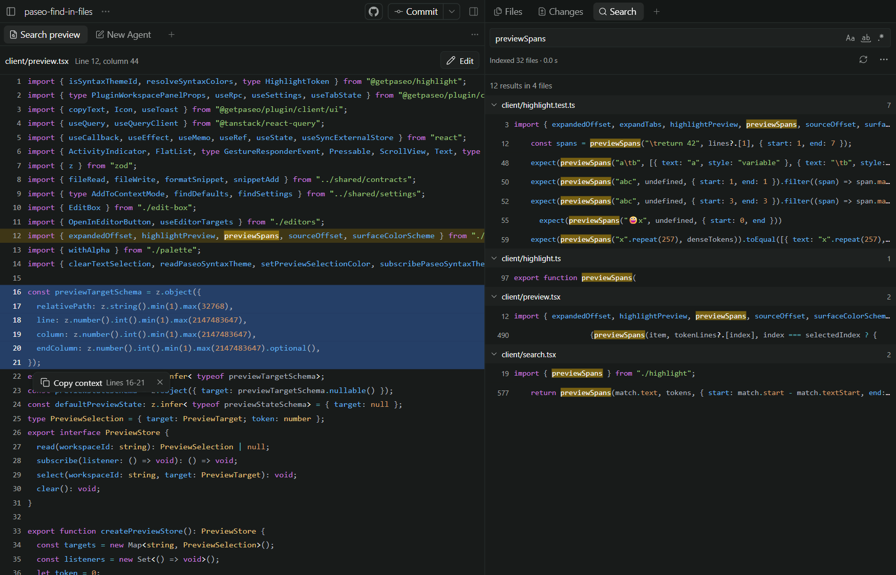

# Find in Files

Search workspace content from the Search tab beside Files and Changes in Paseo's Explorer pane.



## Requirements

Paseo desktop and daemon 0.14.0 or later are required. Search uses Node inside the plugin. No external search program or setup step is required.

The editor buttons require Paseo desktop with its local daemon. Web and mobile clients, and remote daemons, do not show them. The daemon supports Windows, macOS, and Linux. The client uses React Native controls and supports compact layouts.

## Install

```sh
paseo plugin add git:po-trottier/paseo-find-in-files
```

Open the Command Center and select **Find in files** in a workspace. The command opens the Explorer Search tab.

For development, install from a local clone:

```text
npm install
npm run typecheck
npm test
paseo plugin add .
```

After a source change, run `paseo plugin reload find-in-files`. Do not restart Paseo.

## Search and preview

Enter a query. Search starts after a 250 ms delay. Enter starts a pending search immediately. Enter does not repeat an identical active or completed search. A new edit cancels the previous search.

Use Match case, Whole word, or Regex inside the query field to change the search. Select **File filters** below the field to show include and exclude inputs. Each field accepts one glob. Use braces for alternatives, such as `*.{ts,tsx}`.

The status row shows index progress, completion time, and errors. Counts cover all relevant index units, not only files inside a subfolder workspace. Select **Rebuild index** to rebuild them. Searches use a direct scan before the index is ready. The results identify a direct scan.

Automatic indexing stays off for the user's home directory, file system roots, and folders inside OneDrive. Select **Build index** to start it explicitly. Searches in these folders reuse available indexes and scan other files directly. A restored query stays paused until you press Enter or edit it.

Results appear below collapsible file headers. Select a match to reuse the preview tab. The preview header shows the file, line, and column, and an editor button at the right. Select the button to open the file at that line and column in the preferred editor. Select the arrow to choose another editor from the list that Paseo shows in its own workspace header. The result rows also have a button for the preferred editor.

Preview keeps indentation and expands tabs to four-column stops. It colors syntax with the same engine as Paseo. The selected line and query match remain marked. Syntax uses at most 768 KiB of source and a 200 ms work budget. Larger files and lines with more than 256 syntax tokens remain plain text.

### Add to context

Select code in the preview in one of two ways:

- Select a line number, or drag over line numbers to select a range. On web and desktop, shift-click a line number to extend the range. Select a single selected line number again to clear it.
- Drag over the code text. This works on desktop and web.

The preview keeps one selection. A click or a text selection in the code clears the line numbers, and a line number selection clears the text selection.

A floating button appears below the selection. Its label shows what it does, from the plugin settings:

| Setting | Result |
| --- | --- |
| Attachment (default) | **Attach to chat**. Adds the selection to the composer. Select **Add attachment** > **Attach Find in Files selection** in any composer on that host, then pick it. |
| Copy | **Copy context**. Copies the path, line range, and a fenced code block to the clipboard. |
| Both | **Attach and copy**. Does both. |

### Edit

Select **Edit** in the preview header to change the file in a plain text box. On web and desktop, the text keeps its syntax colors. They update after a short pause in typing. Native clients show plain text. Select **Save** to write the file, or **Cancel** to discard the changes. Save keeps the file's line endings and byte order mark. If the file changed on disk after the edit started, the preview shows **Overwrite** and **Discard and reload**. While you edit, a new search result does not replace the editor.

Query options and the preview target remain in tab state after a reload. The plugin settings screen controls the search shortcut. The preview uses the syntax theme from Paseo Settings > Appearance. The plugin reads it from Paseo's internal `@paseo:app-settings` storage on desktop and web, and checks it again each second. Native clients use Paseo's default theme (`one`).

The plugin settings also set two preview colors. **Selection color** (default blue `#3B82F6`) paints selected line numbers and selected code text with the same color. **Match line color** (default amber `#EAB308`) paints the line that holds the search match and the matched text. Select a preset or type a `#RRGGBB` value. The preview adds transparency so the code stays readable.

The default shortcut is **Ctrl+Alt+Shift+F** on Windows and Linux, or **Command+Option+Shift+F** on macOS. Paseo 0.14 does not assign this chord. Its **Ctrl/Command+Shift+F** chord controls focus mode instead. Select the shortcut value in the plugin settings to capture a new chord. Select **Clear** to disable it.

The shortcut works only on web and desktop workspace routes. It stays inactive in detected terminals and modal dialogs. This detection is best effort. Native clients use the Command Center. The shortcut uses an internal route until Paseo provides a plugin shortcut API.

## Data and limits

The daemon resolves the workspace directory through the Paseo SDK. The file walker respects nested `.gitignore` and `.ignore` files. It always excludes `.git` directories and does not follow symbolic links.

The walker includes hidden files and directories unless ignore rules exclude them. Each repository or worktree root has one shared index. Workspaces inside the same root reuse that index and restrict results to their own folders.

A parent-folder search includes nested repositories and submodules. It excludes nested worktrees to prevent duplicate results. A workspace that points at a worktree searches that worktree separately. Each index applies its own ignore files and excludes events from child repositories.

The walker excludes cloud roots from the Windows `OneDrive`, `OneDriveCommercial`, and `OneDriveConsumer` environment variables. This guard does not apply when the workspace itself is inside that cloud root. For such a workspace, automatic indexing stays off, but a search or a Build index reads its files and can download them. Other small remote placeholder files can still download when read.

The index stores lowercase ASCII byte trigrams and file metadata in memory. Search intersects the required trigram lists, then checks candidate files with the actual matcher. Regex plans use only required literal text. A pattern with no safe trigrams scans all eligible files.

The plugin checks each file's size before it opens the file. Search, indexing, and preview skip files above 1 MiB. The plugin skips binary files.

Posting arrays share a 32-million-entry limit. The index marks itself partial when a memory limit prevents more entries. Search checks files that the partial index does not contain directly. The plugin does not save the index to disk. It rebuilds the index after a plugin restart.

Mounted Search tabs keep their index units available. The plugin can remove unused units when it reaches the directory limit.

Index metadata also has limits. A direct scan rejects more than 200,000 candidate files or 16 million path characters instead of exceeding its memory limit.

A recursive file watcher updates changed files and removes deleted files. The plugin rebuilds when old document entries exceed 25 percent. A watcher error marks the index stale. Rebuild the index after a stale status.

Search checks each line with JavaScript regular expressions. Whole word uses Unicode letter, number, and underscore boundaries. A worker isolates each search. Cancellation terminates that worker. A 15-second limit stops an expensive pattern and returns an error.

Each search returns at most 2,000 matches and limits the result data size. Narrow the query or file filters when the truncation notice appears. Paseo 0.14.0 returns the capped results together, not as a stream.

The truncation notice also appears if a file changes during its read or the plugin cannot read a candidate file.

Preview, edit, and add-to-context actions reject paths outside the workspace, including symbolic link escapes. Search results and preview text go to the connected Paseo client. An agent receives a selection only when you attach it to a message.

Result clicks cannot open Paseo's own file tab yet. The plugin uses its preview tab until [Paseo #7318](https://github.com/getpaseo/paseo/pull/7318) provides that API.

The editor list comes from Paseo desktop's internal editor bridge. The plugin also reads Paseo's internal `@paseo:preferred-editor` storage keys. A choice in the plugin menu is kept in the plugin's own `find-in-files:preferred-editor` key and does not change Paseo's choice. Paseo launches the editor on the client machine. The plugin asks Paseo desktop for its local daemon ID with the internal `desktop_daemon_status` command and shows editor buttons only for that daemon, as Paseo does.

Attachment selections stay in daemon memory, newest first, at most 50. A daemon or plugin restart clears them. An attached selection is a text snapshot of the code at the time you added it.

Edit mode saves through the daemon with the same workspace containment checks as preview. Save compares a SHA-256 hash of the file with the hash from when the edit started. The check and the write are not atomic, so a change in that short interval is overwritten. Closing the preview tab discards unsaved edits.

## Development checks

```text
npm run typecheck
npm test
paseo plugin ls
paseo plugin logs find-in-files
```

Tests cover query plans, ignore rules, shared repository units, file size limits, match offsets, and containment. They also cover edit writes, stale-version conflicts, Python syntax tokens, tabs, shortcut chords, and workspace routes. Tests do not launch an editor.

Paseo contracts: [plugin reference](https://paseo.sh/docs/plugins/reference).

## Icon attribution

The Match case, Whole word, and Regex icons come from [Visual Studio Code Codicons](https://github.com/microsoft/vscode-codicons). Microsoft licenses these icons under [Creative Commons Attribution 4.0 International](https://creativecommons.org/licenses/by/4.0/). The plugin embeds their SVG paths and uses the Paseo theme for their color.

## Syntax engine license

The plugin uses `@getpaseo/highlight` 0.14.0. The [Paseo 0.14.0 license](https://github.com/getpaseo/paseo/blob/v0.14.0/LICENSE) covers Paseo code under Apache-2.0. Third-party components retain their own licenses. The package includes an [MIT license for its Astro parser](https://github.com/getpaseo/paseo/blob/v0.14.0/packages/highlight/src/astro/LICENSE).

